# Sayyam Doshi | Portfolio

FP&A and BI analyst who also builds the tools. Since October 2026 I have worked as a Business Applications Developer Intern at ITHENA, building internal business apps with Claude Code and GitHub and running UAT for the company's core systems.

> Case studies only. The applications belong to ITHENA, so no company source code, data or credentials are included. Screenshots use demo data, and company logos are blurred.

---

## iThena Expense (ClearLedger)
Company-wide expense app: category limits, approval routing, trips, receipts, reimbursements and admin policy controls, in light and dark mode and on a phone.

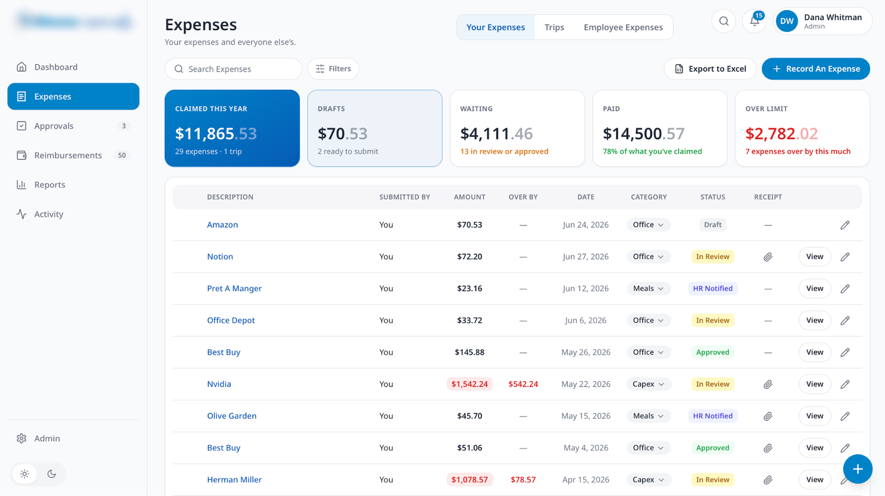
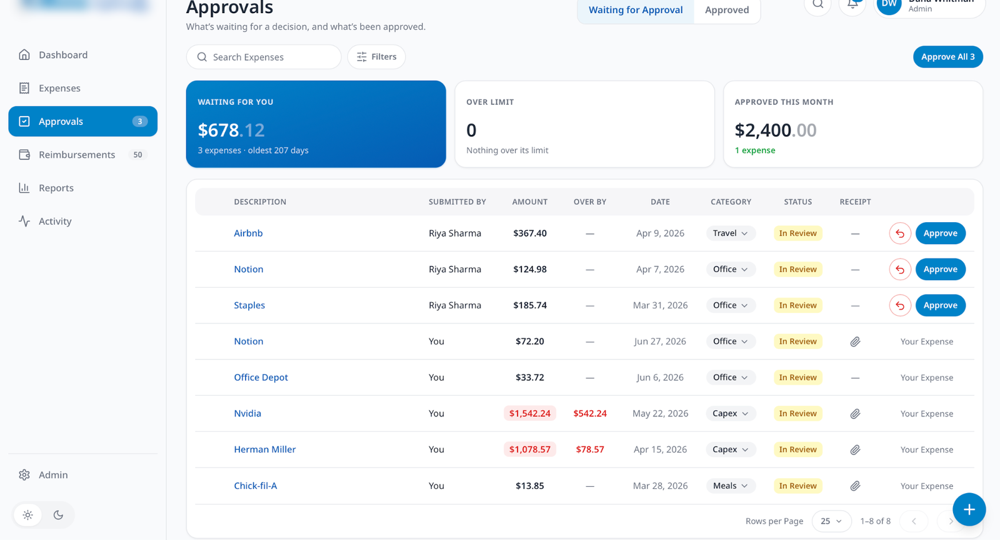

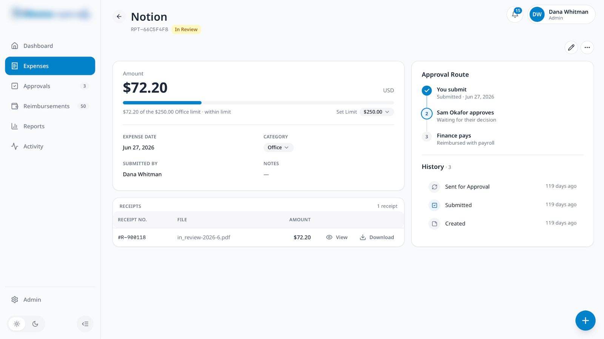
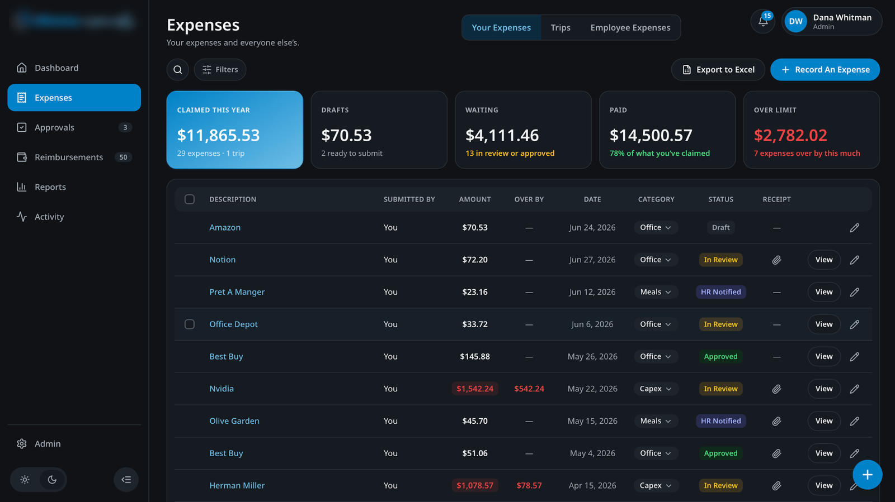

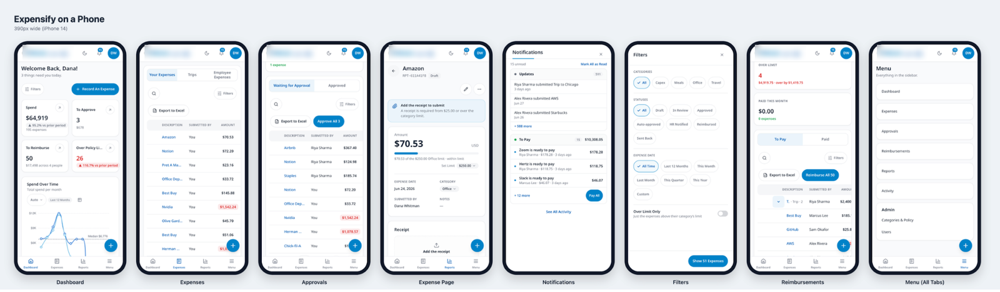

**Stack:** Claude Code, Next.js, GitHub · **Role:** builder · [Full case study](projects/ithena-expense.md)

---

## CRM User Acceptance Testing
451 test cases across 5 CRM areas, 69 findings triaged by severity, plus a roadmap to simplify adoption.

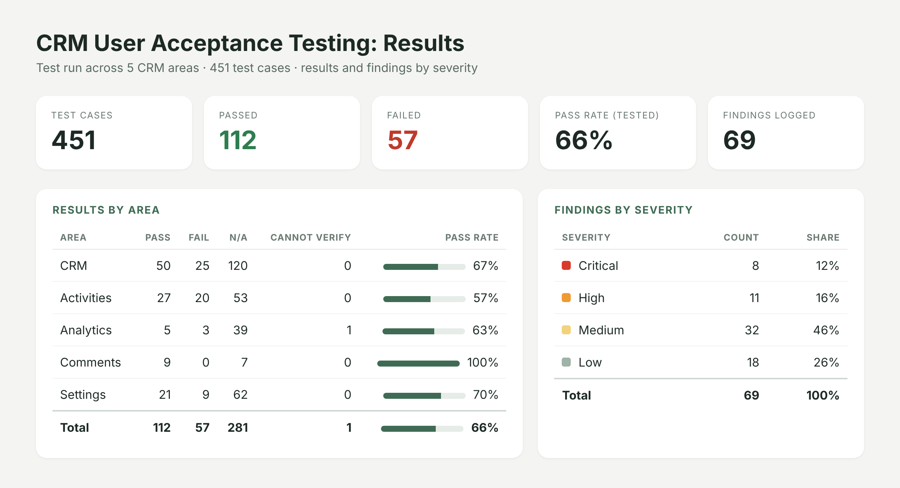

**Role:** tester and co-author of the test plan · [Full case study](projects/crm-uat.md)

---

## iThena People (Onboarding Portal)
Employee onboarding portal built from BRD/PRD requirements, with automated emails and a multi-level sign-off flow.

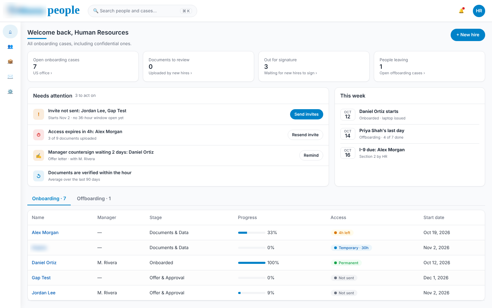
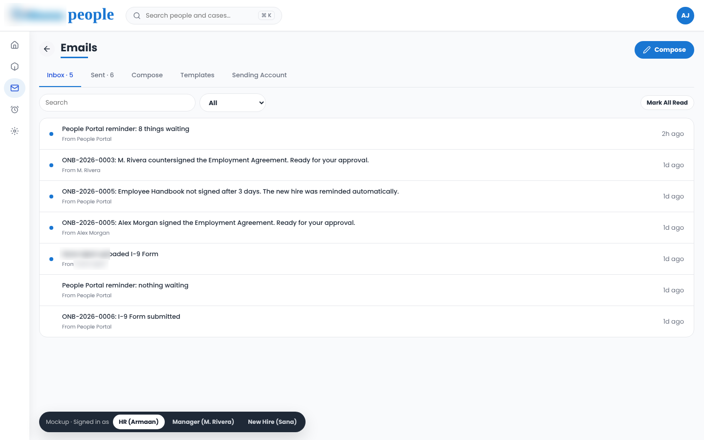

**Stack:** Claude Code, HTML, Git · **Role:** co-builder (UI, email templates, sign-off flow) · [Full case study](projects/ithena-people.md)

---

## Press Scout + CCT
AI media intelligence platform that discovers, audits and ranks B2B publications every week.

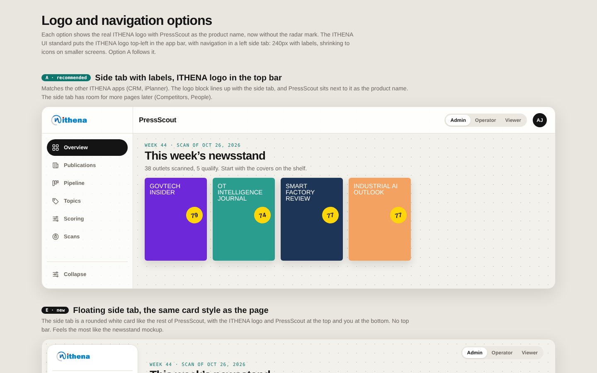
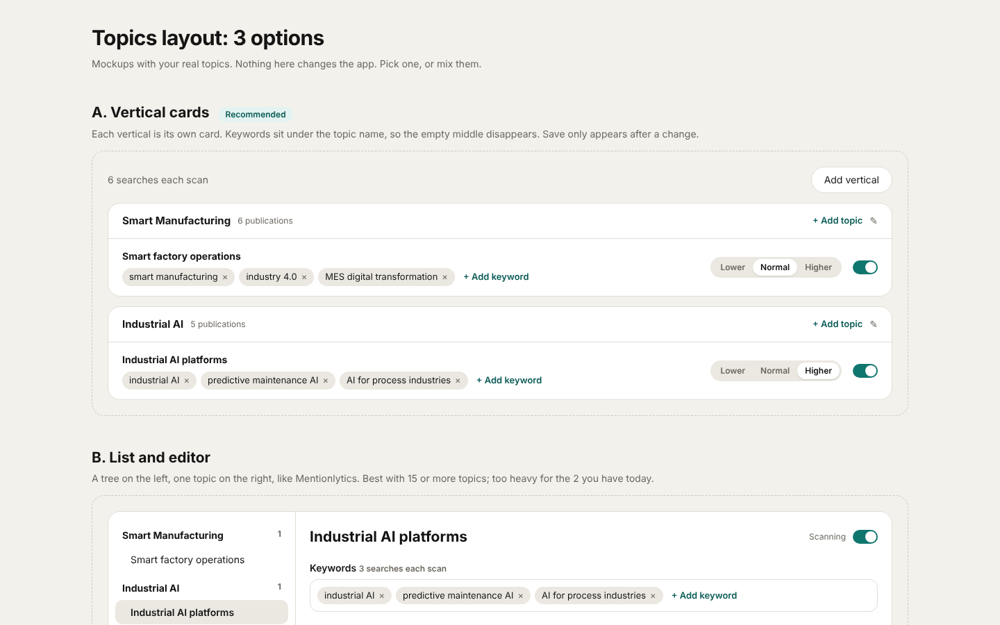

**Stack:** Next.js, TypeScript, PostgreSQL, pg-boss, Tavily API, Gemini Flash-Lite · **Role:** architect · [Full case study](projects/press-scout.md)

---

## Introductory Assessment
Two Java web apps on Apache Tomcat (a login and registration app with a database, and a live weather app on a REST API) plus a Python exercise.

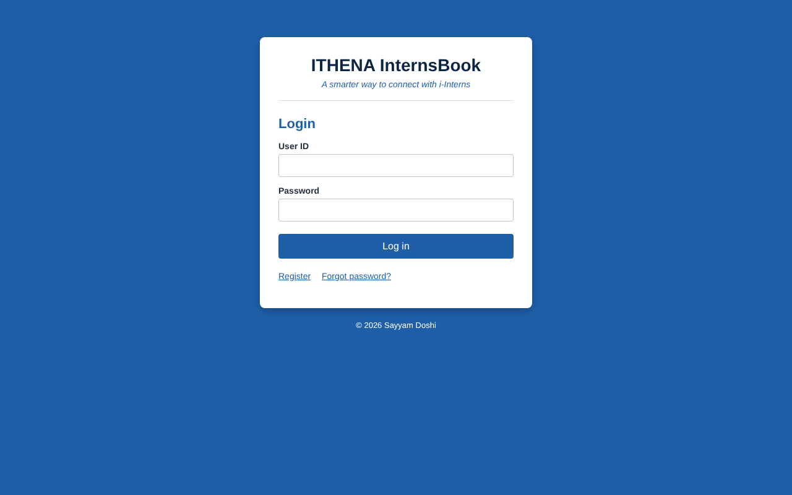
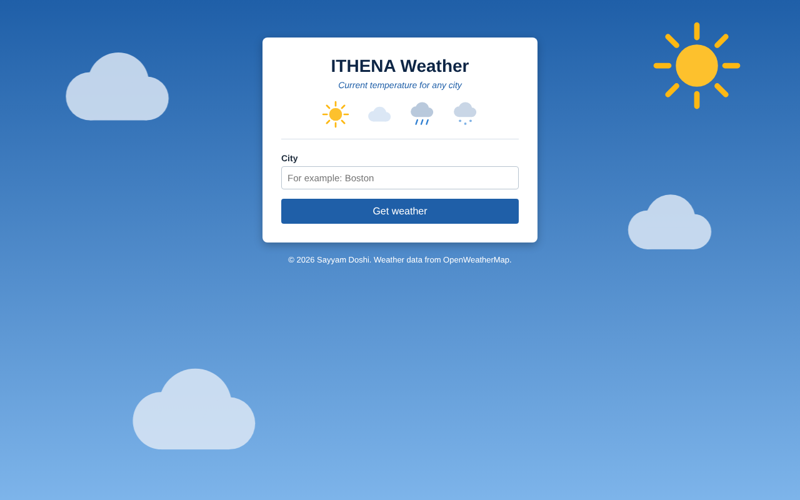

**Stack:** Java (JSP), Tomcat, JDBC, H2, REST, Python · [Full case study](projects/introductory-assessment.md) · [Code](https://github.com/sayyamdoshii/Ithena_Introductory_Assessment)

---

## More
- [Billing App Review](projects/billing-app-review.md): recommended-changes review of the internal Billing app
- [Technical Evaluation](projects/technical-evaluation.md): SQL reconciliation, Tableau SaaS dashboards, Snowflake cost analysis, pipeline design and a CFO dashboard ([code](https://github.com/sayyamdoshii/ithena-technical-evaluation-sayyamdoshi))

## Skills shown here
Requirements to prototype with Claude Code · workflow and approval automation · LLM and API integration · PostgreSQL and background jobs · UAT, test planning and bug triage · FP&A, month-end close, variance analysis and KPI dashboards (Power BI, Tableau, SQL, Python)

## Contact
[LinkedIn](https://www.linkedin.com/in/sayyamdoshi06) · sayyamdoshi06@outlook.com
