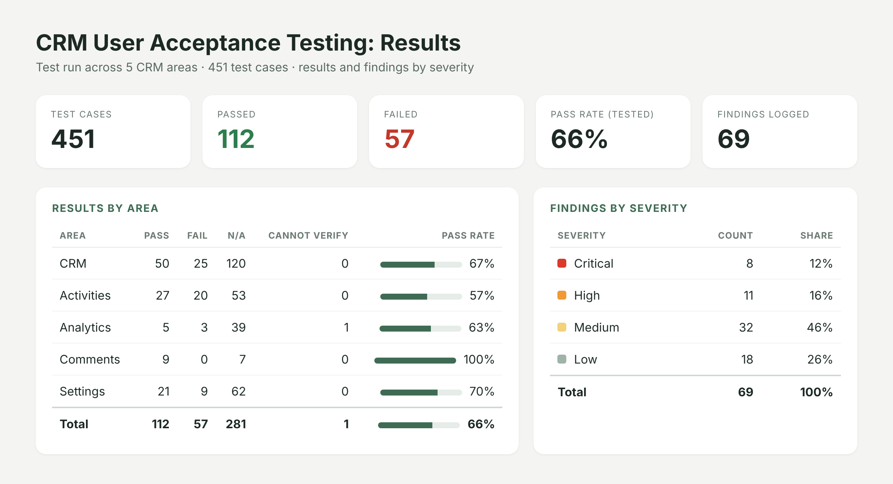

# CRM User Acceptance Testing and Adoption Roadmap

**Type:** User acceptance testing and process improvement
**Role:** Tester, co-author of the test plan, author of the adoption roadmap

## Results

- **451 test cases** across five areas: CRM, Activities, Analytics, Comments and Settings.
- **112 passed, 57 failed**, a 66% pass rate on the cases that applied. 281 were marked N/A and 1 could not be verified.
- **Weakest area:** Activities at 57%. **Strongest:** Comments at 100%.
- **69 findings logged:** 8 critical, 11 high, 32 medium and 18 low, tracked as open, fixed and retest so the most serious issues get fixed first.

## What I did
- Tested from a separate test account so nothing touched production data or sent real notifications.
- Co-authored the testing plan: the order of testing and how bugs are prioritized by severity.
- Tracked results in a workbook that rolls test outcomes up by area and findings up by severity.
- Proposed a 2 to 3 week roadmap for training documentation, help sections and user journeys to make the CRM simpler for end users.
- Moved project documentation, reports and findings into the team's shared drive.

## What I learned
- Adoption problems are often documentation problems. Clear user journeys reduce support questions more than new features do.
- A pass rate only means something next to the N/A count; separating "not applicable" from "failed" kept the numbers honest.
