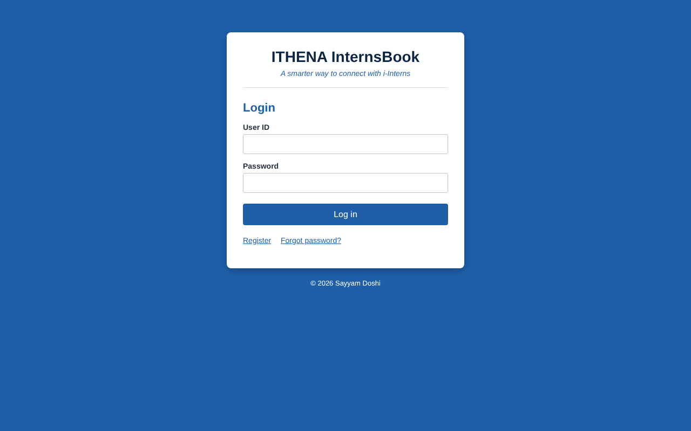
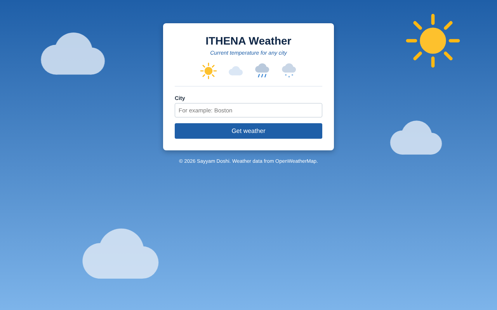

# Introductory Assessment

**Code:** [sayyamdoshii/Ithena_Introductory_Assessment](https://github.com/sayyamdoshii/Ithena_Introductory_Assessment)
**Stack:** Java (JSP), Apache Tomcat, JDBC, H2 database, REST API, HTML/CSS, Python

Three exercises completed as part of joining ITHENA.

## 1. InternsBook: login and registration app
A JSP web app on Tomcat that stores users in a database through JDBC.

- **Login** with user ID and password, checked against the database with a prepared statement.
- **Register** with name, email, date of birth, photo upload, user ID and password, then a confirmation page.
- **Forgot password** by user ID and email.
- **Landing page** with today's date, a welcome message, the user's photo and Log out (session handling).
- One shared database include and one stylesheet so every page behaves and looks the same.

## 2. Weather app: live data from a REST API
A JSP app that calls the OpenWeatherMap API and shows the current weather for any city.

- Sends a GET request with the city and API key, reads temperature, feels-like, description and humidity from the JSON reply.
- Handles errors by HTTP status (city not found, invalid key, service down).
- The background and weather image change with the conditions: sunny, cloudy, rainy or snowy.

## 3. Euclidean distance in Python
A short script that computes the straight-line distance between two points.

_Screenshots show the apps' start screens rendered from the source; company logo removed._
