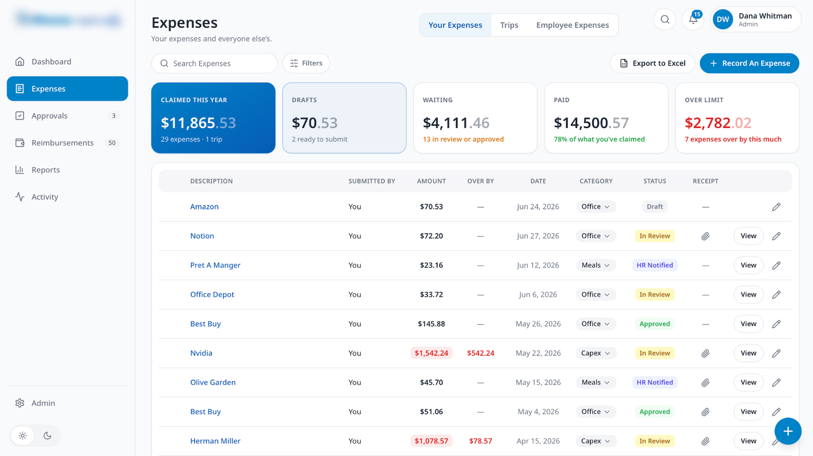
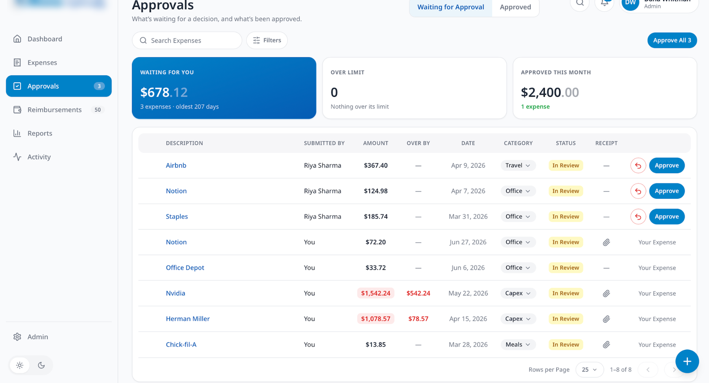
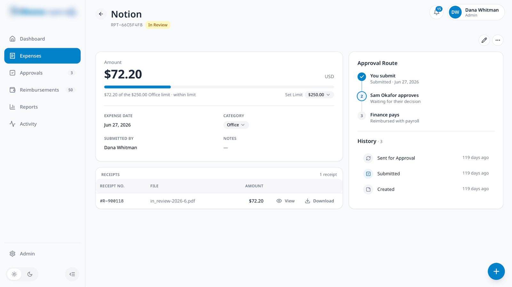
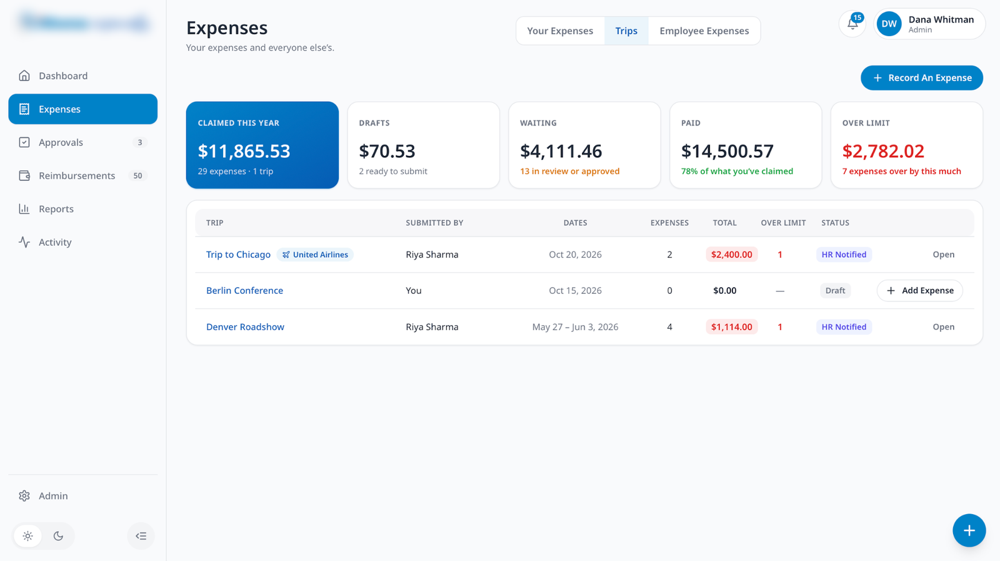
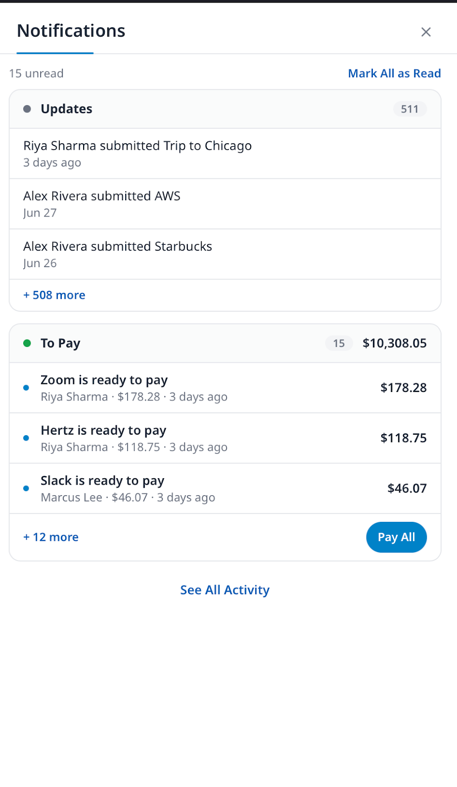
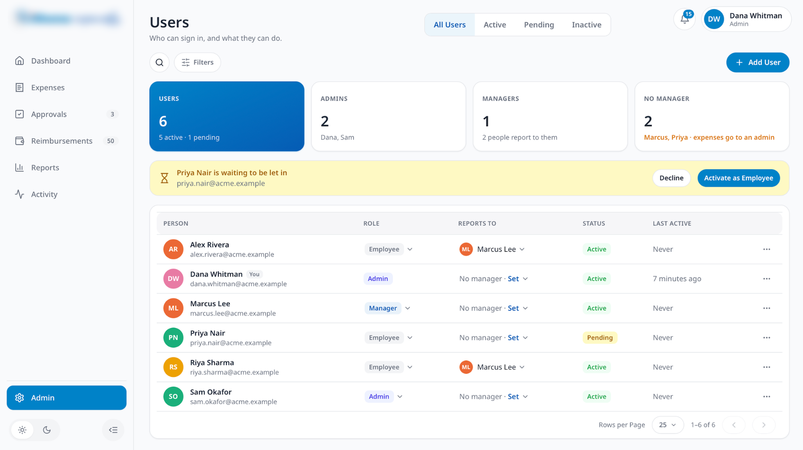
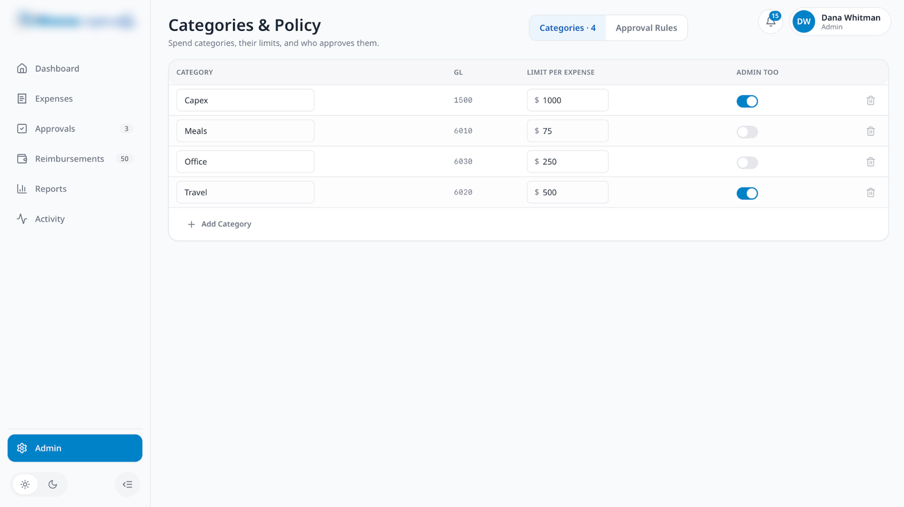
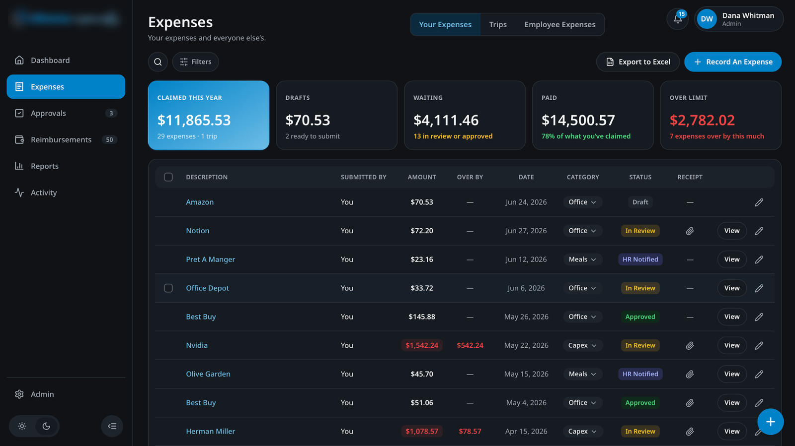
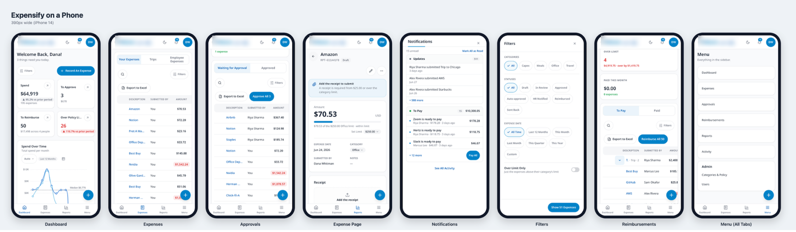

# iThena Expense (ClearLedger)

**Type:** Internal business application (employee expense tracking)
**Stack:** Claude Code, Next.js, GitHub
**Role:** Builder

## Problem
The company needed one place to track employee expenses, enforce spending policy, route approvals and pay people back, with a reliable way to stop the same receipt being claimed twice.

## What I built
- **One consistent layout** on every page: sidebar, page title with view tabs, search and Filters, summary tiles and a rounded table.
- **Expenses:** five summary tiles (Claimed This Year, Drafts, Waiting, Paid, Over Limit) with color meaning (amber waiting, green paid, red over limit), status tags on every row, Export to Excel and Record An Expense.
- **Receipt-level duplicate detection:** keys on the receipt number rather than place, time or amount, so true repeat claims are stopped without blocking legitimate repeat purchases.
- **Approvals:** what is waiting, what is over limit and what was approved this month; Send Back and Approve on each row and Approve All. Your own expenses show "Your Expense" instead of action buttons.
- **Expense page:** the amount against its category limit, the receipt with View and Download, the full Approval Route and History.
- **Trips:** one row per trip with airline, dates, expense count, total and over-limit count; draft trips can be filled and submitted as a whole.
- **Notifications:** grouped by what to do (Updates and To Pay, with a running total and Pay All).
- **Admin:** user management with roles and managers, a banner to let pending people in, categories with GL codes and per-expense limits, and approval rules (receipt required at, auto-approve under, admin review over, manager signature).
- **Reports and Activity:** every submitted expense with its audit trail.
- **Dark mode and a phone layout** at 390px wide.

## Screenshots
_Demo data. Company logo blurred._

**Expenses**

**Approvals**

**Expense page: limit, receipt, approval route and history**

**Trips**

**Notifications**

**Admin: users**

**Admin: categories and policy**

**Dark mode**

**Phone view (390px)**

## What I learned
- Duplicate detection is a business rule first and a code problem second. Choosing the right key (receipt number) mattered more than the algorithm.
- A finance background shapes the design: GL codes, category limits and approval thresholds are what make an expense tool usable for month-end close.
