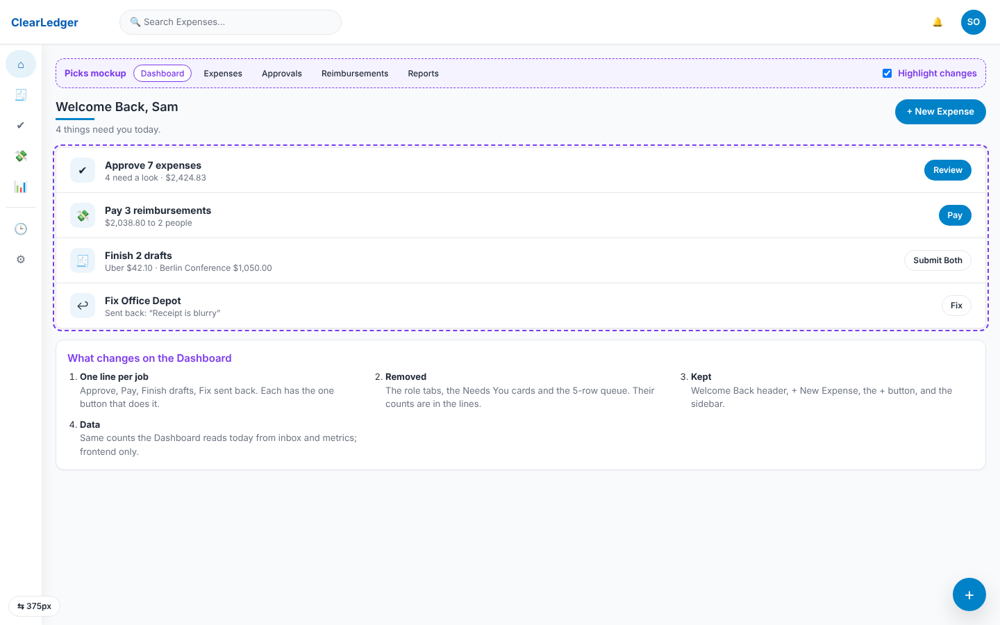
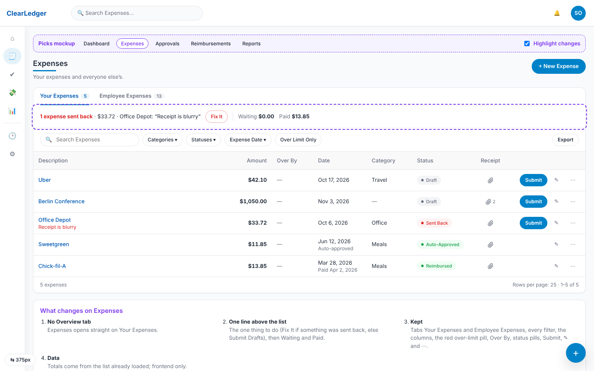
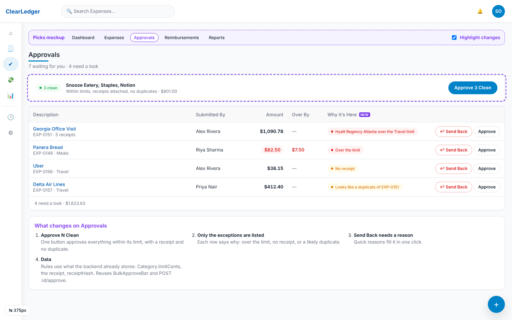
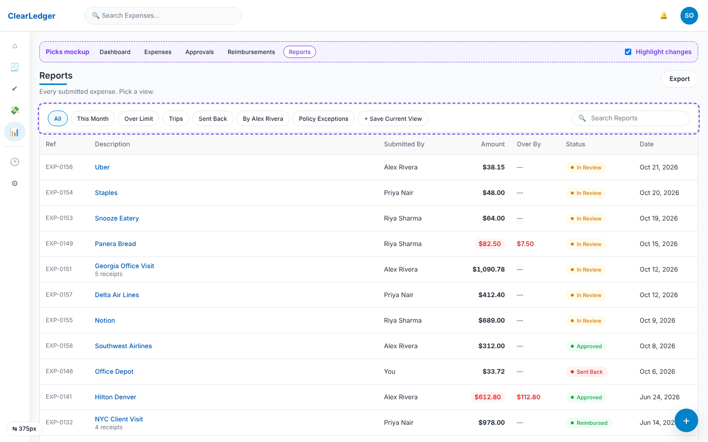

# iThena Expense

**Type:** Internal business application (employee expense tracking)
**Stack:** Claude Code, GitHub, HTML/CSS/JavaScript
**Role:** Builder

## Problem
The company needed one place to track employee expenses and a reliable way to stop the same receipt from being claimed twice.

## What I built
- A company-wide expense tracking application, built through AI-assisted development with Claude Code and versioned in GitHub.
- Receipt-based duplicate detection. Early logic compared location, time and amount, which flagged legitimate repeat purchases. I changed it to key on the receipt number, so true repeat claims are stopped without blocking valid expenses.
- Redesigned the filters, reporting views and UI to speed up approval reviews.

## Screenshots
_Design mockups with sample data. Any real names are blurred._

**Dashboard**

**Expenses list with filters**

**Approvals with duplicate and policy flags**

**Reports**

## What I learned
- Duplicate detection is a business rule first and a code problem second. Choosing the right key (receipt number) mattered more than the algorithm.
- Reviewing the approach with a teammate before building saved a rewrite.

## Outcome
A working internal tool that prevents repeat claims and speeds up approval reviews.
